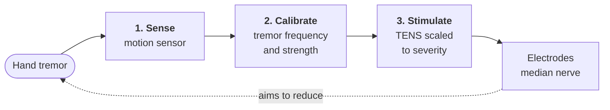
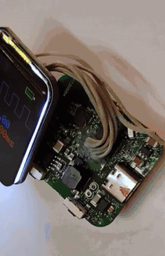
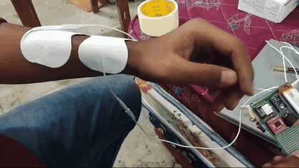
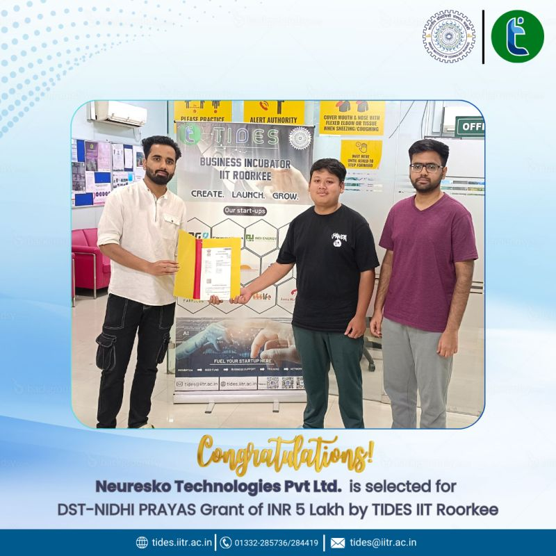

# Neuresko

**A low-cost, wrist-worn device that senses hand tremor and delivers personalised nerve stimulation (TENS), scaled to how strong the tremor is.**

<p align="center">
  
</p>

## The problem

Tremor is one of the most visible symptoms of Parkinson's disease and essential tremor. Shaking hands make everyday tasks hard: eating, drinking from a glass, writing, buttoning a shirt.

Medicines do not help everyone and can have side effects. Deep brain stimulation works, but it needs brain surgery and is expensive. Stimulating the nerves at the wrist is a non-invasive option, but the few wearable devices that do this are expensive and hard to get in India.

Neuresko set out to build an affordable one.

## How it works



1. **Sense.** A 6-axis motion sensor (accelerometer and gyroscope) measures wrist movement continuously.
2. **Calibrate.** The microcontroller picks out the tremor's frequency and strength and sets the stimulation to match.
3. **Stimulate.** Electrodes at the wrist deliver TENS pulses over the median nerve. The signal travels up to the brain circuits where tremor rhythms start (the thalamus), with the aim of disrupting them.

The display shows the current stimulation settings. The device has a manual mode and an automatic mode.

## Hardware

**Custom PCB:** microcontroller · 6-axis motion sensor (accelerometer + gyroscope) · stimulation output stage · Li-ion charging over USB-C · 1.69-inch colour display, in a two-part 3D-printed case on a standard watch strap.

The earlier proof of concept used off-the-shelf modules (ESP32-C3 board, MPU-6050 sensor, driver module).

### PCB

A custom board sized to fit inside a watch case.

<p align="center">
  
</p>

### Housing (CAD)

A two-part case (lower and upper shell) with lugs for a standard watch strap and openings for the charging port and electrode lead.

<p align="center">
  
</p>

## Photos

<table>
  <tr>
    <td align="center"><br><sub>Breadboard prototype</sub></td>
    <td align="center"><br><sub>Proof of concept on a wrist strap</sub></td>
    <td align="center"><br><sub>Custom PCB with display</sub></td>
  </tr>
  <tr>
    <td align="center"><br><sub>Wearable prototype with electrodes</sub></td>
    <td align="center"><br><sub>Display on the wrist</sub></td>
    <td align="center"><br><sub>USB-C charging port</sub></td>
  </tr>
</table>

All photos, stage by stage: [docs/development-stages.md](docs/development-stages.md)

## Demo videos

Previews play at 2× speed. Click one to open the full video.

<table>
  <tr>
    <td align="center" valign="top">
      <a href="media/video/custom-pcb-bench-test.mp4"></a><br>
      <sub><b>Custom PCB bench test:</b> the board and display stepping through stimulation settings, then switching to automatic mode</sub>
    </td>
    <td align="center" valign="top">
      <a href="media/video/proof-of-concept-stimulation-demo.mp4"></a><br>
      <sub><b>Proof of concept:</b> the early circuit driving electrodes on the forearm</sub>
    </td>
  </tr>
</table>

## Project status

**Working prototype. Shelved, not in active development.**

The design went from a breadboard circuit, to a proof of concept built from off-the-shelf modules, to a custom PCB inside a 3D-printed watch case.

## Team

Built by a three-person team.

## Acknowledgement

Incubated at TIDES Business Incubator, IIT Roorkee, and funded by DST, Government of India, under NIDHI-PRAYAS.

Grant period: October 2024 to June 2025.

<p align="center">
  <br>
  <sub>Grant announcement by TIDES Business Incubator, IIT Roorkee (October 2024)</sub>
</p>

## Repository layout

```
hardware/
  pcb/      PCB layout render
  cad/      housing CAD render
media/
  photos/   prototype photos (numbered in build order) and the grant announcement
  video/    demo videos and preview GIFs
docs/
  development-stages.md
```

## Rights

All rights reserved. The images, videos and designs here are shared for viewing only.
