# Development stages

[← Back to README](../README.md)

## 1. Breadboard prototype

The first working circuit on a breadboard: a small microcontroller board, push buttons, and a colour display showing the stimulation amplitude, timing and frequency.

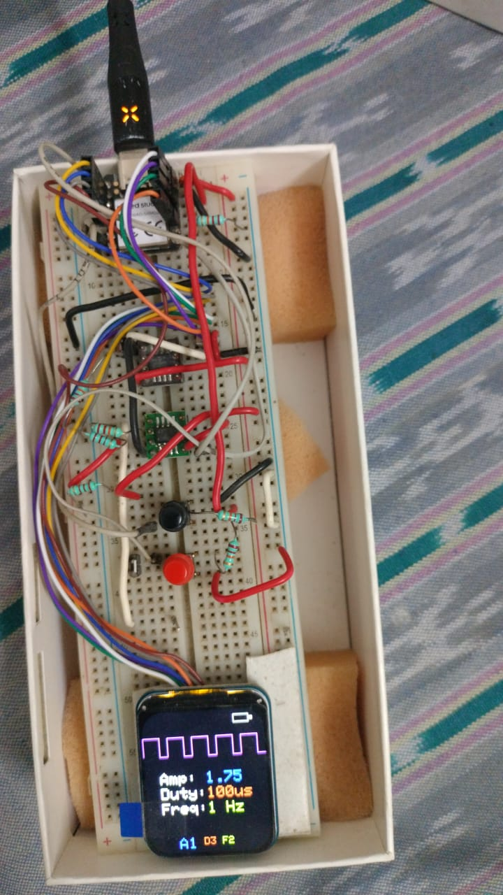

## 2. Proof of concept on the wrist

Off-the-shelf modules (ESP32-C3 board, MPU-6050 motion sensor, driver module, Li-ion battery) on a perfboard inside a clear case, mounted on a neoprene wrist strap. Hydrogel electrodes inside the strap sit over the median nerve.

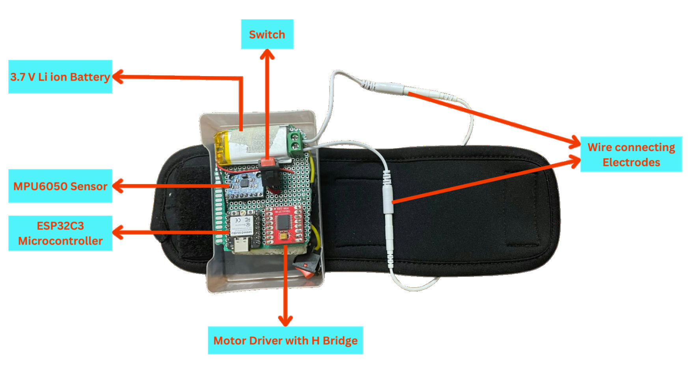

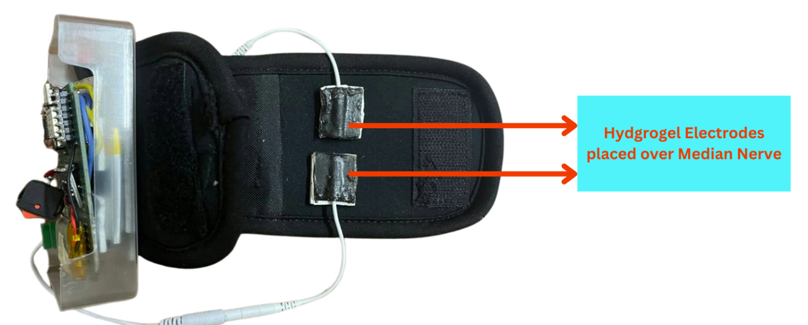

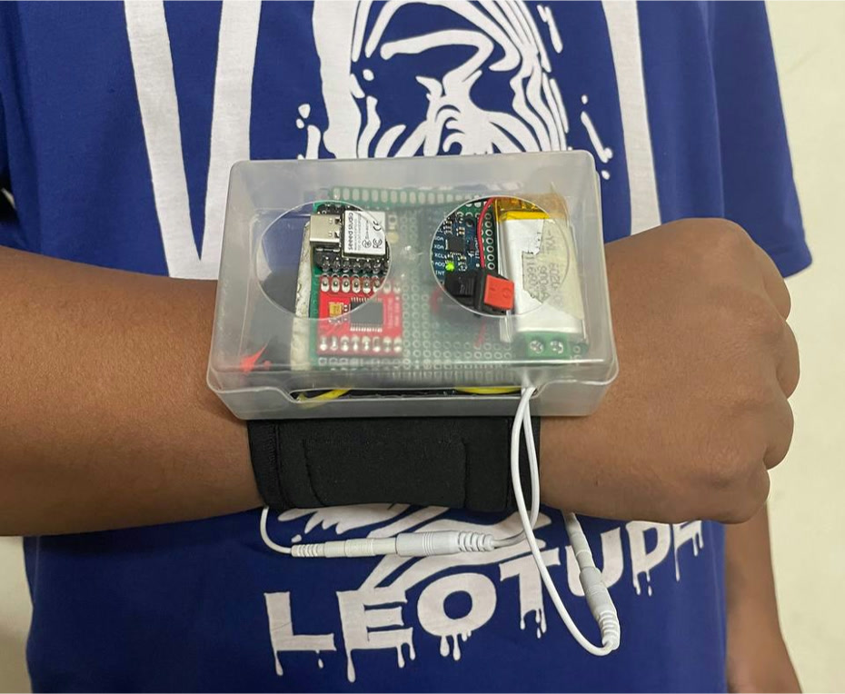

Video: [proof-of-concept-stimulation-demo.mp4](../media/video/proof-of-concept-stimulation-demo.mp4)

## 3. Custom PCB

The electronics moved onto one custom PCB sized for a watch case, with USB-C charging, wired to a 1.69-inch display module and a flat Li-ion cell.

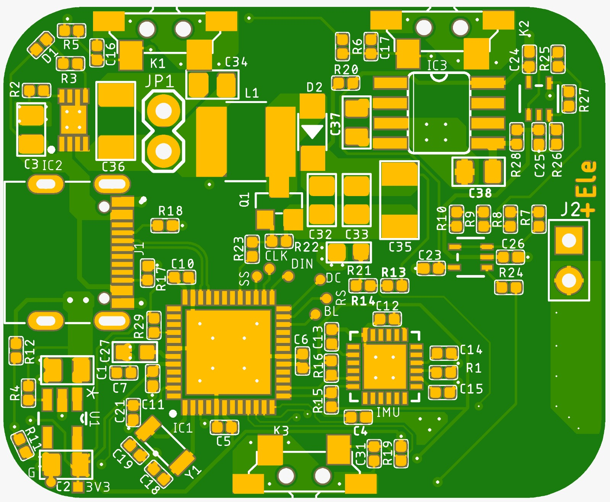

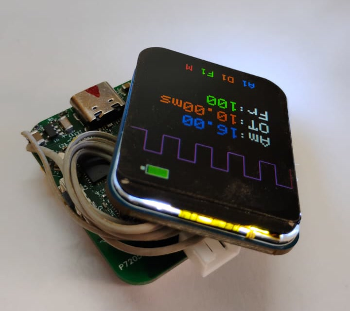
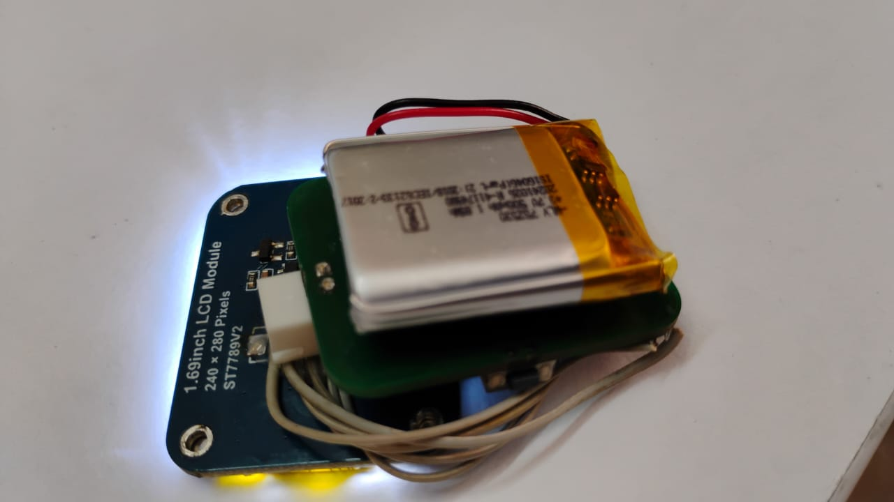

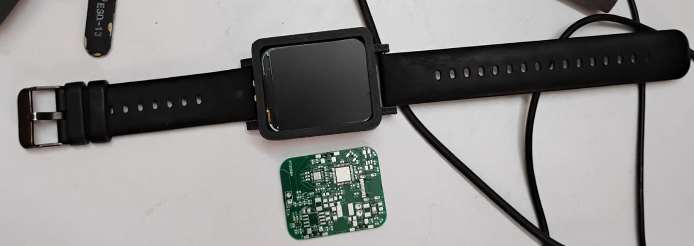

Video: [custom-pcb-bench-test.mp4](../media/video/custom-pcb-bench-test.mp4) (bench test of the board and display, outside the case)

## 4. Wearable prototype

The custom PCB inside a two-part 3D-printed case on a standard watch strap, with electrode pads on a lead. The display shows the current stimulation settings and has an automatic mode.

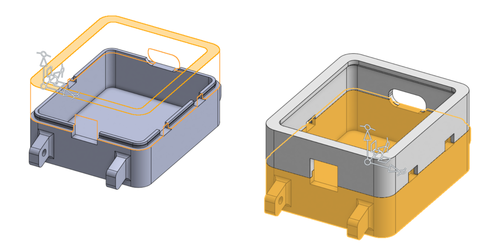

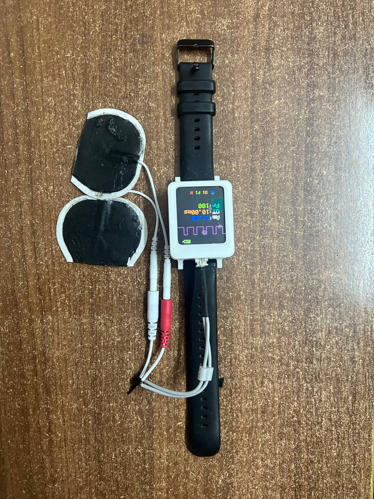
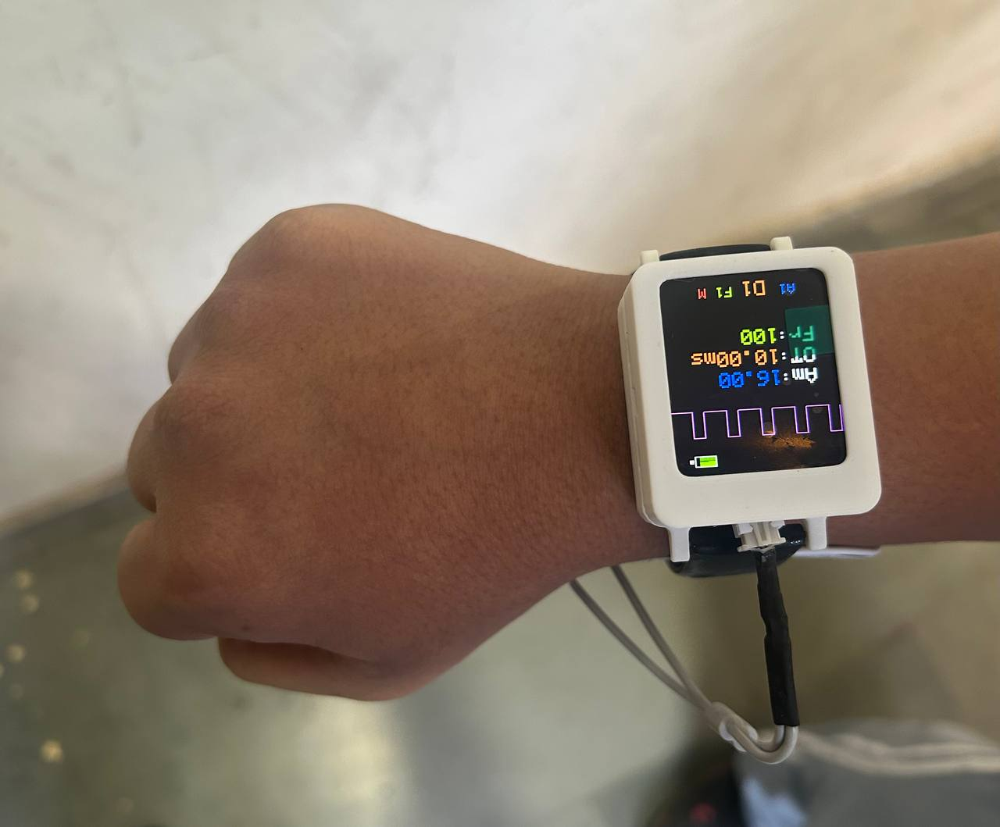

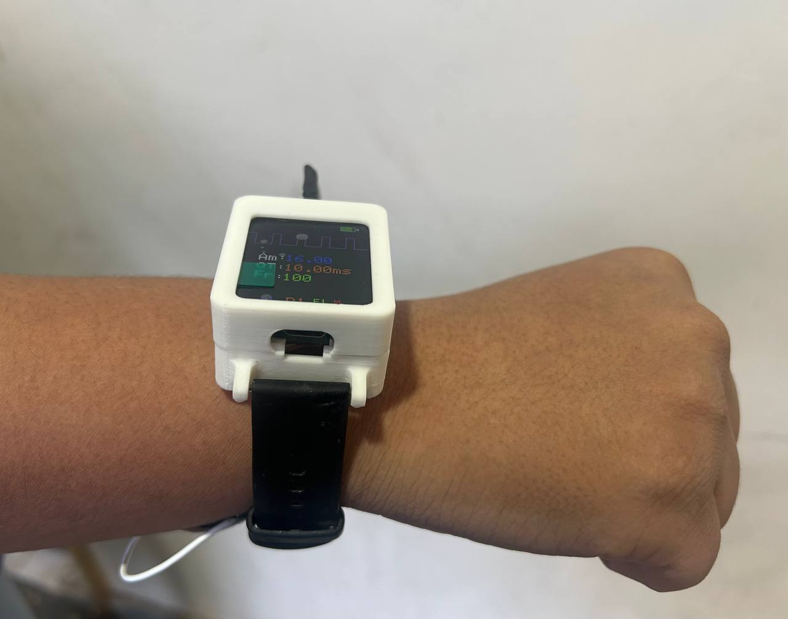
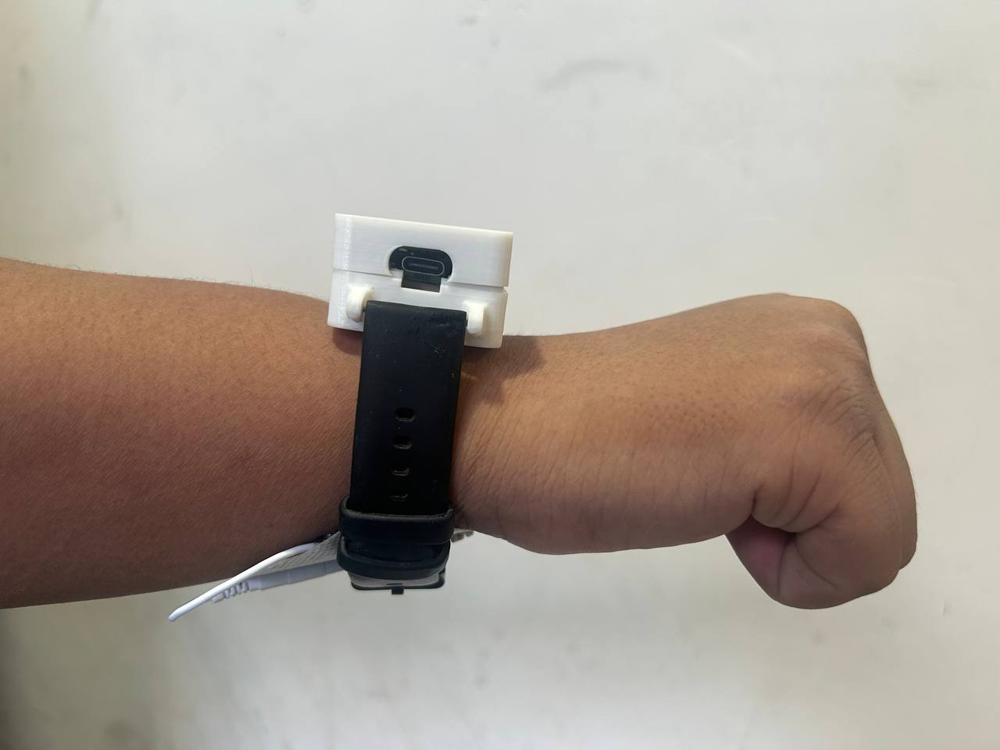

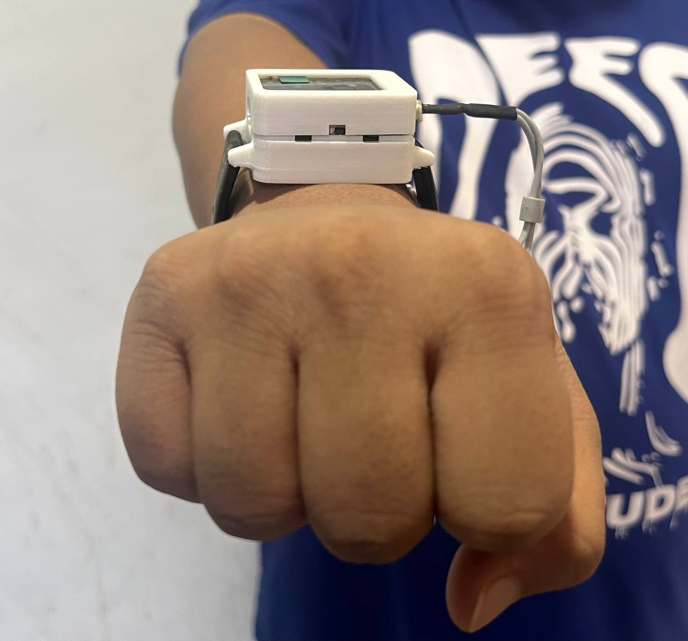
